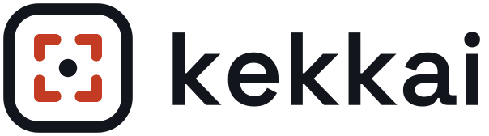

<h1 align="center">
  <picture>
    <source media="(prefers-color-scheme: dark)" srcset="https://raw.githubusercontent.com/alpine-ronin/kekkai/main/docs/brand/logo-dark.svg">
    
  </picture>
</h1>

<p align="center"><b>Keeps an AI coding agent inside the scope it declared.</b></p>

<p align="center">
  <a href="https://github.com/alpine-ronin/kekkai/actions/workflows/ci.yml"></a>
  
  <a href="https://github.com/alpine-ronin/kekkai/blob/main/LICENSE"></a>
</p>

---

Ask an agent to add a price to products and it may also "tidy up" the billing module, rename a shared value object
and touch `composer.lock` on the way. Each change looks reasonable; together they make a diff nobody can review.

*Kekkai* (結界, a barrier) makes the agent say first what it is going to change, then holds it to that:

1. **Declare.** Before its first edit, the agent calls `declare_scope` with the intent and the paths, globs or
   zones of the change (`catalog`, `src/Catalog/**`, `config/services.yaml`).
2. **Guard.** A Claude Code hook checks every `Edit`, `Write`, `MultiEdit` and `NotebookEdit`: outside the scope,
   the edit is refused with the reason and what to do; on a protected file (`composer.lock`, `migrations/`, `.env*`),
   the user decides.
3. **Widen, in the open.** When the task truly needs more, the agent calls `widen_scope` with a reason. The scope
   grows, and the reviewer sees every widening and why.
4. **Check before done.** When the agent stops, Kekkai reads the diff from git, so files changed through the shell
   (`sed -i`, a code generator) are caught too, and runs your checks (`phpgraph check`, PHPUnit, PHPStan) on it.
   Anything failing sends the agent back to work, once.

No LLM, no network. A hook call takes about 50 ms.

## Quick start

Kekkai is not on Packagist yet. Until the first release, add the repository to `composer.json`
(`"repositories": [{"type": "vcs", "url": "https://github.com/alpine-ronin/kekkai"}]`) and require `dev-main`.
Other ways: [docs/INSTALL.md](docs/INSTALL.md).

```bash
composer require --dev alpine-ronin/kekkai:dev-main
vendor/bin/kekkai init                    # writes kekkai.yaml
vendor/bin/kekkai install claude --write  # hooks in .claude/settings.json, MCP server in .mcp.json
```

Commit `kekkai.yaml`, `.claude/settings.json` and `.mcp.json` so the whole team gets the same guard, then restart
Claude Code and approve the `kekkai` MCP server.

## kekkai.yaml

```yaml
zones:                       # named sets of paths, one per bounded context for instance
  catalog: ['src/Catalog/', 'tests/Catalog/']
  billing: ['src/Billing/', 'tests/Billing/']

protected:                   # the user approves these edits, whatever the scope
  - composer.lock
  - '.env*'
  - 'migrations/'

always-allowed:              # allowed whatever the scope
  - CHANGELOG.md

without-scope: ask           # edit before any scope: allow, ask or deny
outside-scope: deny          # edit outside the scope: ask (the user decides) or deny
allow-widen: true            # false: only the user widens, with `kekkai scope widen`

checks:                      # run on the diff by `kekkai check` and when the agent stops
  - name: architecture
    run: phpgraph check
  - name: tests
    run: vendor/bin/phpunit
    timeout: 600
```

Patterns are relative to the project root: `*` and `?` within a directory, `**` across directories, and a path
without wildcard is that file or that directory with everything in it. Checks get the changed files, one per line, in
`$KEKKAI_CHANGED_FILES`.

The agent can never edit `kekkai.yaml`, `.kekkai/` (where the scope lives) or `.git/`. A scope covering the whole
project (`**`) is refused.

## With phpgraph

[phpgraph](https://github.com/alpine-ronin/phpgraph) already checks the architecture: layers, dependency rules,
the bounded context of each handler. Kekkai doesn't redo it; it runs it on the diff, before the agent stops:

```yaml
checks:
  - name: architecture
    run: phpgraph check
```

phpgraph says whether the code respects the architecture; Kekkai says whether the agent stayed on its task. With
[Airlock](https://github.com/alpine-ronin/airlock) guarding the shell commands, the agent's three ways of acting on a
project are covered: reading, running, editing.

## Commands

| Command | What it does |
|---|---|
| `kekkai init` | Writes a commented `kekkai.yaml`. |
| `kekkai install claude [--write]` | Prints, or merges into `.claude/settings.json` and `.mcp.json`, the hooks and the MCP server. |
| `kekkai scope [show]` | The current scope and its widenings. |
| `kekkai scope declare <paths>... -m "<intent>"` | Declares the scope yourself, before handing the task over. |
| `kekkai scope widen <paths>... -m "<reason>"` | Widens it (the only way when `allow-widen: false`). |
| `kekkai scope clear` | Ends the task: the next one declares its own scope. |
| `kekkai check [--base main] [--no-checks] [--format json]` | Changed files outside the scope, and the checks. Fails with exit code 1, for CI too. |
| `kekkai hook pre-tool-use \| stop` | The Claude Code hooks (JSON on stdin). |
| `kekkai serve` | The MCP server: `declare_scope`, `widen_scope`, `show_scope`, `check_changes`. |

## What it does not do

- **It is not a sandbox.** The scope is declared by the agent itself: Kekkai stops drift, not an agent set on getting
  around it. A shell command can still write outside the scope; the stop check catches it in the diff afterwards,
  it does not prevent it. To control shell commands, use Airlock.
- **Hooks are for Claude Code only for now.** Any MCP client can use the server and `kekkai check`, but only Claude
  Code refuses the edit before it happens.
- **One scope per project at a time**, stored in `.kekkai/scope.json`: two agents working in the same checkout share
  it. Use one worktree per agent.
- **The stop check sends the agent back once.** If it still fails, Claude Code lets it stop, so a check that can
  never pass does not loop forever: read the report yourself.

## Documentation

| | |
|---|---|
| [SPEC.md](docs/SPEC.md) | The specification: rules in order, scope lifecycle, files, review, hook and MCP protocols, exit codes |
| [CONFIGURATION.md](docs/CONFIGURATION.md) | Every key of `kekkai.yaml`, choosing the policy, zones from bounded contexts, checks |
| [HOOKS.md](docs/HOOKS.md) | Claude Code setup and a task step by step |
| [MCP-TOOLS.md](docs/MCP-TOOLS.md) | The four tools, their arguments and answers |
| [CLI.md](docs/CLI.md) | Every command, and Kekkai in CI |
| [INSTALL.md](docs/INSTALL.md) | Composer, global, from source |
| [ARCHITECTURE.md](docs/ARCHITECTURE.md) | The code, the flows, the design rules |
| [DECISIONS.md](docs/DECISIONS.md) | Why it works this way |
| [LIMITATIONS.md](docs/LIMITATIONS.md) | What it does not cover |
| [schemas/](docs/schemas) | JSON schemas of the scope file and of `kekkai check --format json` |
| [brand/](docs/brand) | Logo, icon, social preview |

## License

MIT
